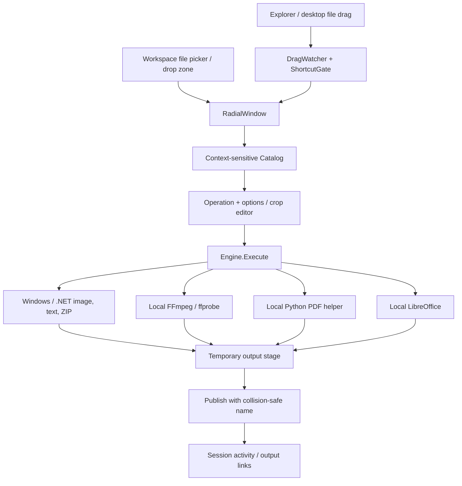

# Architecture

ShiftDrag runs as one native WPF application. WinForms provides the notification-area icon; Windows hooks observe modifier keys during file drags. Work is routed to .NET implementations or separate local engine processes.

## Lifetime

`App.Main` enforces a single running UI instance with a named local mutex. Minimizing and closing hide the dashboard. The tray icon can reopen it, pause shortcuts, choose files, open the shelf, or explicitly quit. The application uses explicit shutdown so hiding the main window does not exit.

Preferences serialize to `%LOCALAPPDATA%\ShiftDrag\settings.json`. The shelf and activity history remain in memory for the session. The shelf stores file references and supports dragging them to other apps.

## Wheel and drag stability

`ShortcutGate` accepts the first modifier key-down and ignores repeats until key-up. A mode update is idempotent when the active mode already matches. The external drag uses one root drop surface rather than overlapping child drop targets. File data and segment geometry are cached; drawing updates when the selection changes. The Copy feedback remains stable until Drop; the center still cancels.

`WheelLayout` divides options into pages of at most eight. `WheelDrawing` draws the translucent segments, glass-style center, and selection. The overlay uses actual alpha transparency. Native Acrylic was removed after visual testing produced an opaque rectangle. See [the QA record](../research/QA-ui-and-drag.md) for evidence and verification limits.

## Operation and output flow

`Catalog` derives file families and offers actions based on selection and engine availability. Options are collected before execution; the visual crop editor returns a concrete pixel rectangle. `Engine.Execute` runs operations asynchronously and reports completed outputs.

Conversions write to a temporary stage and publish on success with a collision-safe filename. Cancellation removes the active partial stage; completed batch outputs remain available. Conversion operations preserve originals. Explicit file moves are a separate user-selected action.

## Local engines

External executables are invoked with Windows argument quoting, redirected output/error streams, and cancellation handling. PDF requests are temporary local JSON files removed after the helper finishes. FFmpeg presets trade encoding time against compression; compatible mute/metadata paths try stream copy before a re-encoding fallback.

The PDF helper uses pypdf for text and document operations, PDFium for rendering, and Pillow for image serialization. Office conversion delegates to a separately installed LibreOffice executable. Optional engines are discovered locally; there is no remote processing service.
