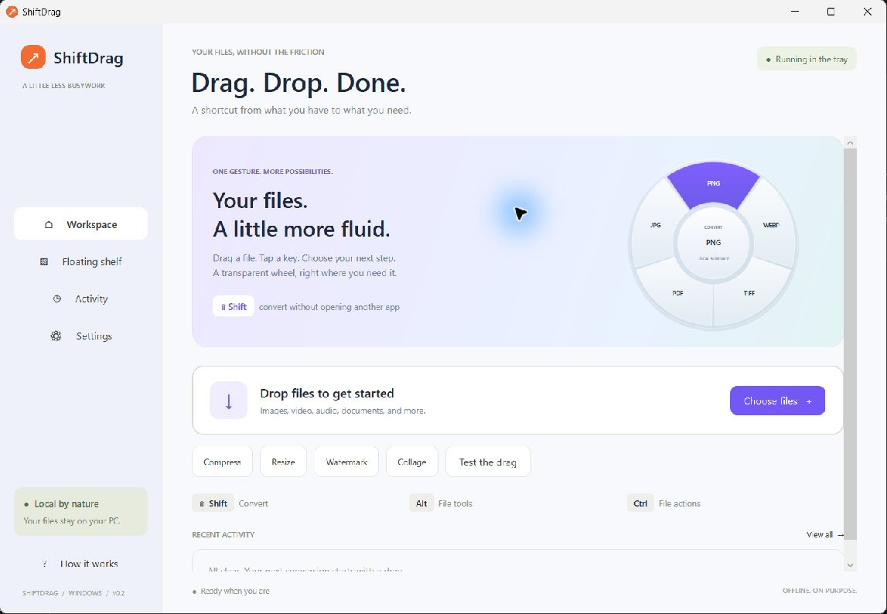
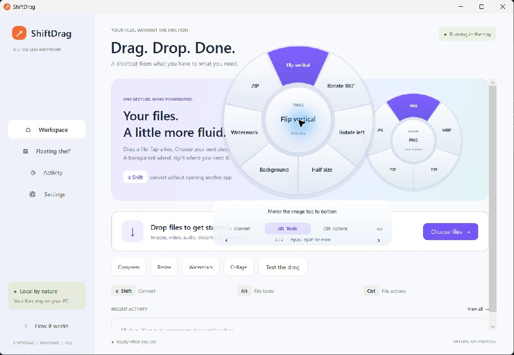

# Screenshots

These captures show the actual v0.2 Windows application. They are not mockups.

## Workspace

The workspace offers file selection, drag-and-drop, quick image tools, tray status, and navigation to the floating shelf, activity, and settings.

## Glass-style tools wheel

The wheel uses per-pixel transparency with translucent gradients and a purple selection. The capture shows page two of the image tools and a selected vertical flip. The appearance uses glass-style tinting; native Acrylic backdrop blur is disabled because it produced an opaque rectangle in the tested WPF overlay.

## Reference captures

The [research directory](../research/RESEARCH.md) preserves the requested source investigation:

- [Full reference website screenshot](../research/tangerine-website.jpg)
- [Website hero](../research/tangerine-hero.jpg)
- [X demo frame 1](../research/x-demo.jpg), [frame 2](../research/x-demo-2.jpg), [frame 3](../research/x-demo-3.jpg)
- Homepage, tools, press, and privacy text snapshots, plus [all format categories](../research/categories.json)

These reference captures depict third-party material, credited to their original owners. They are separate from ShiftDrag's own screenshots and application assets. See [third-party notices](../THIRD_PARTY_NOTICES.md).
